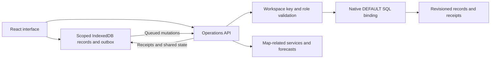

# Field Commander

**Give every field visit the context it needs.**

Field Commander helps delivery, maintenance and community service teams coordinate assignments, understand access conditions and record what happened on site. Work can be saved on a device while offline, then synchronized with explicit server receipts when connectivity returns.

Built by **Obed Onyedika Inya** with React, TypeScript, Rust and a managed SQL database on BlinkHost. Open source under the [MIT license](LICENSE).

[Open the application](https://field-commander-blink.blinkhost.website) · [Design decisions](docs/DESIGN.md) · [Contribute](CONTRIBUTING.md) · [Security](SECURITY.md)


[About the creator](https://onyedika.blinkhost.website/about) · [Project case study](https://onyedika.blinkhost.website/_server_islands/api/read/work/field-commander)

## Where it helps

| Situation | What the team can do |
| --- | --- |
| A delivery reaches the wrong entrance or an inaccessible crossing | Save practical entrance details and time-limited access observations for the destination. |
| Dispatchers plan visits without knowing the conditions last seen by field staff | Review recent, vehicle-relevant reports and capture those reports with an assignment's plan. |
| A technician loses signal before submitting an outcome | Save the update locally, retain it across reloads and synchronize it after reconnecting. |
| Two people edit the same record | Review a revision conflict and choose the shared version or rebase the latest local edits. |
| A supervisor needs to understand why a visit failed | Review recorded outcomes, planning evidence and photo-supported observations. |
| A small team needs shared operations without requiring every service subscription | Use public maps and MET Norway forecasts; enable optional address search and road routing separately. |

The central workflow connects **sites → assignments → field observations → outcomes**. It keeps operational context alongside the work, including the time and vehicle applicability of an observation and the evidence available when the visit was planned.

## A typical working day

1. **Set up destinations.** An owner or dispatcher adds sites with coordinates, an address, entrance instructions and contact details. Address search is available when Geoapify is enabled; manual coordinates and device location also work.
2. **Give visits an owner.** Create assignments with a destination, assignee, vehicle, priority and due time. Applicable access observations are saved with the plan.
3. **Check conditions.** Review recent reports, forecast times and selected stops. A simple proximity order works without a routing key; Geoapify adds driving estimates for supported trips.
4. **Capture the visit.** Field members update their assigned work and submit access observations. Reports include severity, observed time, expiry, vehicle applicability and optional compressed photo evidence.
5. **Close the loop.** Record completion or failure and its outcome. Dispatchers review observations. Device queues show pending changes, rejected updates and revision conflicts rather than claiming every save is synchronized.

The application starts at sign-in. New workspaces contain no operational records until the team creates them.

## Capabilities

- Shared assignments, sites, access observations and photo evidence.
- Owner, dispatcher, field and viewer roles, enforced by the backend.
- Individual member access keys with owner-controlled issuance and revocation.
- Offline device storage, scoped by both workspace and member.
- Persistent mutation queues and idempotent operation receipts.
- Revision conflict recovery and database-generation guards.
- Time-limited, vehicle-relevant access evidence and plan snapshots.
- Interactive MapLibre maps with OpenFreeMap and OpenStreetMap attribution.
- MET Norway forecasts with provider timestamps and caching.
- Optional Geoapify geocoding and driving estimates; optional WeatherAPI forecasts.
- CSV exports, device backups and browser persistence controls.
- Responsive navigation, keyboard-accessible controls and explicit empty/error states.

## Service requirements

| Service | Required? | Account/key | What it provides |
| --- | --- | --- | --- |
| BlinkHost and its managed database | Yes for the included deployment | Hosting account and project configuration | Rust WASI runtime, native SQL binding and backend secrets |
| OpenFreeMap / OpenStreetMap | No account for the supplied map integration | No key | Hosted map tiles and geographic context |
| MET Norway | No account for the supplied integration | Identifying application contact URL | Forecasts |
| Geoapify | Optional | Signup and API key | Address search and driving estimates |
| WeatherAPI | Optional | Signup and API key | Alternative forecasts |

Free provider plans have usage limits and terms that can change. Hosting and database usage are separate from free map/weather access. The application remains usable without Geoapify or WeatherAPI: destinations can be entered manually, trips can use proximity ordering, and MET Norway supplies forecasts. It does not substitute invented provider results when a service is unavailable.

## Run the frontend locally

Use Node.js 22 or later and npm.

```bash
git clone https://github.com/Kajahkura/Field-Commander.git
cd Field-Commander
npm ci
cp .env.example .env.local
```

Set `FC_BACKEND_ORIGIN` in `.env.local` to an authorized development deployment with the operations module and database configured. Vite proxies `/_server_islands/operations` to that backend; the setting is not a browser API key.

```bash
npm run dev
```

Open `http://127.0.0.1:4317` and sign in with that workspace's access key. A local frontend without a configured backend can render the sign-in screen but cannot authenticate or synchronize records. Use a separate development workspace to avoid modifying production records.

## Deploy on BlinkHost

The repository includes `blinkhost.yaml`, the frontend and a Rust module at `_server_islands/operations`. It contains the source needed to build the app; the managed runtime and database are hosting services.

1. Create a BlinkHost project in the workspace you intend to use and import this repository.
2. Provision a managed database and bind it as **`DEFAULT`**. Apply `database/DEFAULT/migrations/0001_initial.sql` through the project's database interface.
3. Configure the backend secrets below. Generate a private owner key, for example with `openssl rand -hex 32`. Keep it out of source and frontend environment variables.
4. Build the Rust module for `wasm32-wasip1` with SDK/ABI version `1.1.0` / `blinkhost-wasi-1`. The default Cargo feature uses the native binding.
5. Build the frontend with `npm ci` and `npm run build`, deploy `dist`, and publish the project with its operations module enabled.
6. Verify sign-in, an authorized write, receipt retry, field permissions and recovery after reconnecting before inviting members.

For deployments requiring offline dependency resolution, vendor the locked Rust dependencies first:

```bash
cd _server_islands/operations
mkdir -p .cargo
cargo +1.88.0 vendor --locked vendor/crates > .cargo/config.toml
cd ../..
```

The vendored crates and generated Cargo source configuration are deliberately excluded from Git. `scripts/package-module.py`, `scripts/package-compact-module.py` and `scripts/compact-extract.rs` support packaging original source and dependencies for constrained source delivery; they do not contain precompiled application binaries. The compact packager accepts an unpacked module-source directory and a new output directory. Validate any package with an offline WASI build before upload.

### Backend configuration

| Secret | Purpose |
| --- | --- |
| `FIELD_WORKSPACE_ID` | Stable logical workspace identifier |
| `FIELD_WORKSPACE_NAME` | Display name, defaulting to Field Commander |
| `FIELD_OWNER_NAME` | Owner display name |
| `FIELD_OWNER_KEY` | Private random owner credential; use at least 32 bytes of entropy |
| `FIELD_DB_ID` | Expected managed database identity for the native `DEFAULT` binding |
| `FIELD_DB_GENERATION` | Expected database generation; use the binding's generation and update deliberately after replacement or restore |
| `FIELD_CONTACT_URL` | HTTPS application/contact URL used to identify MET Norway requests; defaults to this repository |
| `GEOAPIFY_API_KEY` | Optional Geoapify credential |
| `WEATHERAPI_API_KEY` | Optional WeatherAPI credential |

The compatibility adapter is selected only by compiling with `--no-default-features`; it additionally requires `FIELD_DB_URL`, `FIELD_DB_TOKEN` and the expected generation. The production configuration uses the native binding. Optional provider keys remain on the backend.

## Technical implementation

### Request and data flow



The frontend uses Vite and TypeScript. The Rust backend compiles to a WASI module served at `/_server_islands/operations`; every operation is an authenticated JSON POST. Maps render through MapLibre and use public OpenFreeMap resources.

### Offline synchronization and concurrency

Each device cache belongs to a **workspace/member pair**. Saving a record atomically writes the optimistic version and an outbox operation into IndexedDB. An operation carries a unique ID, expected revision and expected database generation.

The backend validates authorization and referenced records, then conditionally appends a revision to `fc_events`. Unique constraints and revision checks protect concurrent writes. A repeated operation with the same payload returns its original receipt; reuse with different content is rejected.

A receipt for an earlier operation does not overwrite later local edits. Pull reconciliation applies the shared snapshot while preserving pending entities. A conflict blocks dependent changes until the user chooses the shared version or rebases their latest local edit with a fresh operation ID. A database-generation mismatch requires recovery rather than applying an old queue to a replacement database.

Sign-out clears credentials and visible workspace content. Device records and pending work remain available for recovery. Revoked access clears the active screen when an authenticated request is rejected. Previously downloaded data cannot be remotely erased from a disconnected device.

### Data model

| Table | Responsibility |
| --- | --- |
| `fc_events` | Revisioned entity payloads, operation receipts, actor and recording time |
| `fc_members` | Member identities, roles, hashed keys and active status |
| `fc_cache` | Expiring forecast, geocoding and routing responses |
| `fc_quota` | Workspace provider budgets with daily, minute and second bounds |

Entities are sites, assignments, access reports and photos. Reports retain observation and expiry times; assignments retain relevant planning evidence. Photos are compressed JPEG data, bounded by the backend to keep request sizes predictable.

Native application reads currently request authoritative `primary` consistency. Local browser storage serves previously downloaded records offline. This is distinct from a server-side embedded database replica. Database latency optimizations are outside this release; remote requests may remain slow.

### API actions

| Action | Behavior / access |
| --- | --- |
| `login` | Validate the key; return identity, members and configured-service availability |
| `state` | Read paginated workspace state |
| `mutate` | Validate role, author/assignment scope, revision and generation; return a receipt |
| `weather` | Fetch or reuse forecasts for valid coordinates |
| `geocode` | Owner/dispatcher address search |
| `route` | Driving estimates for 2–8 stops when Geoapify is enabled |
| `invite` | Owner issues a new individual member key |
| `revoke` | Owner disables a member's future authenticated requests |

Keys travel in the `Authorization: Bearer …` header. API responses are not cached by the service worker. Invalid access, rejected input, conflicting revisions and unavailable services produce explicit errors.

### Source layout

```text
src/                         React UI, domain logic, sessions and offline storage
public/                      App icon, original illustration and licensed fonts
_server_islands/operations/  Rust backend and included SDK bindings
database/DEFAULT/            Baseline schema and numbered migrations
scripts/                     Build, browser/backend checks and source packaging
tests/                       Database transaction checks
docs/                        Product decisions and source references
```

## Validation

```bash
npm test
npm run build
python3 tests/database_test.py
```

For backend validation, install Rust 1.88, the WASI target and the Python test dependency:

```bash
rustup toolchain install 1.88.0
rustup target add wasm32-wasip1 --toolchain 1.88.0
python3 -m venv .venv
.venv/bin/pip install -r requirements-dev.txt
cargo +1.88.0 build --locked --release --target wasm32-wasip1 \
  --manifest-path _server_islands/operations/Cargo.toml
.venv/bin/python scripts/backend-check.py \
  _server_islands/operations/target/wasm32-wasip1/release/field-commander-operations.wasm
```

If you set `CARGO_TARGET_DIR`, use that output path instead. The backend check executes the compiled WASI binary against a local SQL protocol fixture; it does not attest a deployed runtime.

For browser validation, build first and run a production preview in one terminal:

```bash
npx playwright install chromium
npx vite preview --host 127.0.0.1 --port 4317
```

Then run `node scripts/browser-check.mjs` in another terminal. `FC_BASE_URL` and `FC_ARTIFACT_DIR` can override the preview URL and screenshot directory. The checks exercise real browser storage, offline reloads, receipt retries, conflicts, revoked access, account isolation and mobile navigation against a local API fixture.

## Operating boundaries

- Team access keys provide the included identity model. Enterprise SSO and multifactor authentication are not implemented.
- Members can read their shared workspace; edit permissions are narrower. Separate teams requiring private records need separate workspaces.
- Browser storage can be evicted. Requesting persistence helps, but device exports and managed database backups remain necessary. Device exports are for recovery; there is no automatic backup-import UI.
- Basemaps and live provider requests need connectivity. The service worker caches the app shell, not a downloadable offline map region.
- Stop ordering is a proximity heuristic. Driving estimates do not automatically avoid field-reported hazards or certify vehicle clearance.
- Reports are observations. Review status does not independently verify a hazard or guarantee safe access.
- The included checks cover defined behaviors, not an independent security audit, accessibility certification or large-scale load assessment.

See [SECURITY.md](SECURITY.md) for device and hosting boundaries and [THIRD_PARTY_NOTICES.md](THIRD_PARTY_NOTICES.md) for licenses and service terms.
